# Finalized Market Data, Custom LSM Storage & ML Research

An offline-first Python research system for validating completed market bars, preserving exact market content, recovering a single-writer LSM database, and evaluating compatible next-bar classifiers. The recommended demonstration uses synthetic REST fixtures and real temporary storage. It needs Python 3.11+ and no third-party packages, credentials, broker, exchange connection, or trading account.

The problem is preserving identity, chronology and recovery boundaries between ingestion, durable storage and research. This project emphasizes reproducible failure tests and explicit limits rather than execution speed or trading returns.

```mermaid
flowchart LR
  S[Synthetic REST / injected source] --> F[FinalizedBarFetcher]
  F --> V[MARKET_BAR_V1]
  V --> P[OfflineBarPipeline + BarProcessor]
  P --> D[AcceptedBarStore + single-writer LSM]
  D --> R[Reopen + chronological replay]
  R --> FE[Shared bounded features]
  FE --> M[Purged walk-forward research + model metadata]
  M --> G[Explicit inference gates]
  V -. optional transport .-> K[market-bars-v1 Kafka]
  K -. fake-tested adapters .-> P
```



## Quickstart

From the repository root, with Python 3.11 or 3.12:

```bash
python3 -B -m tools.demo
python3 -B -m unittest discover -s tests -v
python3 -B -m tools.verify
python3 -B -m tools.benchmark --records 200
```

`tools.demo` exercises post-close selection, schema precision, durable writes, duplicate suppression, gap/conflict handling, restart reconciliation, feature generation, model compatibility and replay gating. It trains a deterministic logistic classifier solely as a **synthetic functional fixture**. It does not execute paper orders or make network requests. `tools.verify` captures actual results in [docs/verification](docs/verification). Python installation is the only offline setup requirement; run from the project root. No editable install is necessary.

The same mandatory checks run from a source archive without `.git`. That mode explicitly reports Git history as **NOT RUN** and security clearance as **INCOMPLETE**. It is not release approval. Strict release verification additionally requires actual Git history and an owner-provided source-bound review; see [release hardening](docs/FINAL_RELEASE_HARDENING.md).

## Implemented and verified locally

- MARKET_BAR_V1: exact decimal strings, strict timestamps, composite identity and metadata-insensitive duplicate detection.
- Injected finalized Binance REST normalization: request-start time evidence, bounded retries/pages, conflicts and missing intervals. No live exchange response has been verified.
- Per-stream continuity, bounded history, conflict fencing and replay-safe inference eligibility.
- Durable acceptance adapter: storage acknowledgement is separate from in-memory acceptance. Storage failure fences continuation; recovery requires reopening/reconciliation and replay.
- LSM internals: typed integer/string keys, null values, synchronized WAL/replay, atomic SSTable publication and WAL retirement, generation ordering and manual full compaction. Fault/restart and randomized tests preserve existing contracts.
- Shared 60-bar 1m features, train-only standardization, purged expanding validation, final holdout, majority baseline, provenance and JSON model metadata.
- Disabled-by-default isolated paper ledger with fees, slippage, deduplication and explicit state restoration. No real order-submission implementation.

## Implemented with external verification blocked

Kafka adapters observe producer acknowledgements and commit only after durable effects or proven replay duplicates. Restart deliberately replays retained history from trusted starts; offset commits alone cannot restore processor state. Offline fake tests cover crash windows. The optional client is pinned, but **Compose startup is BLOCKED**: the unsupported Confluent 7.5.0 services were removed and replacement compatibility remains unverified. No broker test was run. See [Kafka recovery](docs/KAFKA_RECOVERY.md) and the [security review](docs/FINAL_RELEASE_HARDENING.md#security-review-2026-11-06).

Optional XGBoost training/native JSON serialization is implemented behind lazy imports. Dependencies and a reviewed real-market dataset were unavailable. No XGBoost results or real-market predictive/trading performance are claimed. The standard-library logistic path is verified on fixtures only. See [ML methodology](docs/ML_METHODOLOGY.md).

## Trade-offs and supported limits

This is a single-threaded, single-writer educational system. Whole JSON SSTables and linear scans favor inspectability over scale. Full manual compaction bounds table accumulation when explicitly requested. No background compactor, WebSocket client, exactly-once delivery, high availability, HFT performance, profitable strategy or production readiness is claimed. Failure recovery requires authoritative replay history; unresolved gaps stop progress rather than synthesizing candles.

File and directory synchronization and hard-link publication require a compatible local filesystem. Tests simulate process failures and injected errors; they do not prove hardware power-loss safety. Legacy mixed/ambiguous table layouts fail closed and require owner-reviewed migration. No user data is migrated or deleted.

## Optional workflows

- [Reproducibility and optional Kafka setup](docs/REPRODUCIBILITY.md)
- [Architecture and contracts](docs/ARCHITECTURE.md)
- [Engineering decisions](docs/ENGINEERING_DECISIONS.md)
- [Testing and evidence](docs/TESTING.md)
- [Master plan and findings](docs/ENGINEERING_MASTER_PLAN.md)
- [Progress checkpoint](docs/ENGINEERING_PROGRESS.md)
- [Release and security checklist](docs/RELEASE_READINESS.md)

Old fetchers/trainers are deprecated, separate from v1, and their command-line entry points are disabled. Imports are inert; optional dependencies load only on explicit legacy construction. Legacy network library calls require `ALLOW_LEGACY_NETWORK=1`. The old paper bot refuses construction, and the old import-time backtester is disabled. `storage_engine.data_lake_worker` remains a compatibility-only raw-market-data API tested by Phase 1; use the versioned Kafka path for new work. Old CSV/pickle models are not implicitly accepted or converted.

## Research and portfolio description

“Built and fault-tested a single-writer Python LSM store with WAL recovery and atomic SSTable publication; integrated finalized market-bar validation, replay-safe persistence, and shared features with purged time-series evaluation. Verified offline recovery and transport failure semantics using deterministic fixtures.”

This is infrastructure and research-methodology evidence, not financial advice or profitability evidence. Before publication, review the [release checklist](docs/RELEASE_READINESS.md), optional dependencies, Git author metadata and the handoff archive. Future work: real-data evaluation, authorized broker integration, measured indexing improvements, durable feature checkpoints and independent recovery review.
